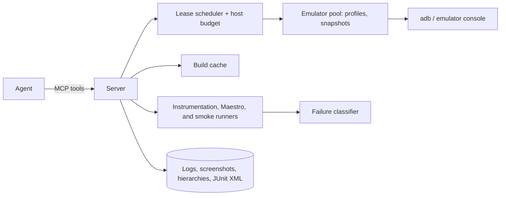

# Device Lab MCP: implementation plan

## Status

Planning only. The server, tools, profiles, and tests described here are not implemented.

## Problem and goal

Concurrent Android testing can overload a host, leak device state between runs, and make application failures difficult to distinguish from test or infrastructure failures. Agents need exclusive access to healthy, isolated devices, predictable builds and state, and structured evidence without managing emulator commands themselves.

Build an MCP server for deterministic, parallel-safe Android device work on a single host. Cloud device farms, iOS, and provisioning physical devices beyond adb passthrough are out of scope.

## Success criteria

- An agent can lease a device, run instrumentation and Maestro suites, and retrieve structured results without raw adb or emulator commands.
- Each test operation starts from its declared state; state does not leak between runs.
- The scheduler respects the configured host budget, and agents cannot operate on devices they do not lease or on user-owned emulators.
- Failures include an `app`, `test`, or `environment` classification and supporting evidence.
- An unattended representative campaign covering instrumentation, Maestro, and release smoke completes within a configurable time target.

## Architecture

Implement the MCP server in TypeScript on Node or Bun, invoking the Android emulator, adb, Gradle wrapper, and Maestro. Store leases, builds, runs, and artifact indexes in SQLite; keep artifacts in a per-run directory and return their paths in results.

## Components

### Host budget and lease scheduler

- Compute the initial emulator budget as `min(floor(free_RAM_GB / 4), floor(cores / 3))`, with a configuration override. Limit builds separately, defaulting to one release and two debug builds.
- `lease_device(profile, ttl)` returns a lease ID and serial, queues when the budget is full, and wipes the device on expiry. Support heartbeats for long-running work.
- Operate only on lab-created devices and honor a configurable serial deny-list. Never touch a user-owned emulator.

### Device profiles and provisioning

- Define YAML profiles for system image, API, RAM, cores, GPU mode, root requirement, locale, and density. Provide a default-image host-GPU profile and a software-GPU fallback.
- Create AVDs from profile `.ini` and `config.ini` files when `avdmanager` is unavailable. Verify the image is installed and install missing images via `sdkmanager` when available.
- Check `sys.boot_completed`, package-manager responsiveness, absence of a System UI ANR window, and an unlocked screen. Retry once with a cold boot and `-wipe-data`, then fail the lease as an environment error.
- Optionally maintain a clean-booted quick-boot snapshot per profile.

### Build cache

- `build(commit|worktree, variants)` uses an isolated Gradle build directory and a separate `--project-cache-dir`, returning APK/AAB paths, signing digest, and version code.
- Key cached builds by tree hash and variant; concurrent requests for the same key share one build. Serialize release builds globally.

### App-state control

- `reset_app(serial, package)` clears app data, revokes runtime permissions, removes notification-listener grants, and restores font scale, display size and density, locale, automatic time, and unlocked rotation.
- `install(serial, apk, mode)` handles debug/release signing conflicts by uninstalling when needed, then verifies the installed version and signer.
- `set_device_state` controls locale, font scale, display size, clock where root is available, dark mode, battery saver, network conditions, and rotation.
- Every runner resets the app and applies the declared state first. Unsupported capabilities must be reported rather than silently skipped.

### Runners

- `run_instrumentation(lease, apk, testApk, filter?)` streams JUnit XML, fails if zero tests run, and captures relevant logcat on process crashes.
- `run_maestro(lease, flows[], env)` returns per-flow results and failure screenshots and hierarchies. Rerun each failed flow once in isolation and mark a pass-on-rerun as flaky.
- `smoke_release(lease, apk, script)` launches the app, checks `FLAG_SECURE` via window state, and scans app-UID logcat for relevant missing-class or method and component-registration failures.
- `screen(lease)` returns hierarchy text, using retries and an accessibility-dump fallback, and a screenshot annotated when secure-window protection causes a blackout.

### Failure classifier

Use explicit rules without an LLM. Every verdict includes evidence lines and artifact paths.

- `environment`: device offline, System UI ANR, incomplete boot, install failure, emulator process death, or host load above the configured threshold.
- `test`: a missing selector when the hierarchy shows the expected screen with changed copy, a pass on isolated rerun, or an assertion on state that reset should have established.
- `app`: an app crash with app stack frames, an assertion failure on the expected screen, or an app-package ANR.

### Multi-device scenarios

Provide `lease_group(n, profile)` under the same host budget, plus adb reverse helpers and local-backend routing through the emulator host mapping.

## MCP tool surface

| Tool | Purpose |
|---|---|
| `lab_status` | Budget, leases, queued requests, host load |
| `lease_device` / `release_device` / `lease_group` | Exclusive devices with TTL |
| `build` | Cached, isolated variant builds for a tree |
| `install` / `reset_app` / `set_device_state` | Deterministic app and device state |
| `run_instrumentation` / `run_maestro` / `smoke_release` | Typed runs and structured results |
| `screen` / `logcat` / `pull_artifact` | Observation |
| `classify_failure` | Re-run triage on a stored failure |

All tools return JSON with `status`, `artifacts[]`, `classification`, and `evidence[]`.

## Milestones

1. **Lease, profiles, and health:** scheduler, deny-list, profile-based AVD creation, boot checks, and `lab_status`. Exit: concurrent agents remain within a configured host budget and leave user-owned emulators untouched.
2. **Build cache, install, and reset:** isolated Gradle builds, artifact cache, signature-aware installation, and state reset. Exit: synthetic fixture app debug, test, and release artifacts are built once and reused across runs.
3. **Runners:** instrumentation, Maestro, and release smoke with artifacts and isolated reruns. Exit: the synthetic fixture app's suites return structured results and zero-test runs are detected.
4. **Classifier and multi-device:** evidence-backed rules and `lease_group`. Exit: synthetic stale-selector, leftover-state, System UI ANR, and app-crash fixtures are classified correctly.
5. **Hardening:** snapshots, server crash recovery, orphaned-emulator cleanup, and documentation.

## Testing

- Use fake adb and emulator binaries for scheduler and classifier unit tests.
- Run integration tests against a real emulator in a controlled local or CI environment.
- Build a synthetic fixture app and synthetic logs and hierarchies for reproducible runner tests and classifier golden cases; do not use private app data or recordings.

## Risks

- Host GPU behavior varies: provide a software-GPU fallback profile.
- Play images may lack root-only capabilities: declare capabilities in profiles and return `unsupported` where appropriate.
- Crashed agents may leave leases behind: use TTLs, heartbeats, and orphan cleanup.

## Kit compatibility

This tool is also a component of [android-kit](https://github.com/fridaysundaymood/android-kit/blob/main/IMPLEMENTATION_PLAN.md). From its first milestone it follows the kit composability rules: the shared result schema (`kit-schema`), its own section in `android-kit.yaml`, artifacts under `.android-kit/runs/<run-id>/<tool>/`, prefixed MCP tool names, a library-first design with thin CLI and MCP adapters, and tests against the shared synthetic `kit-fixture-app`.
